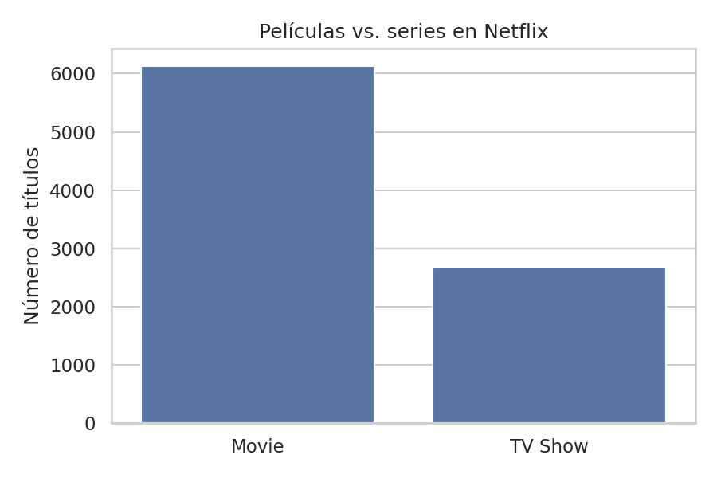
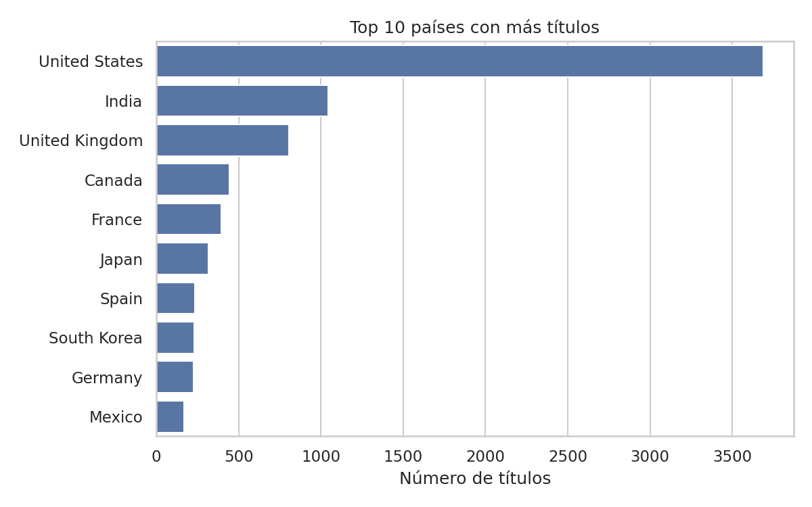
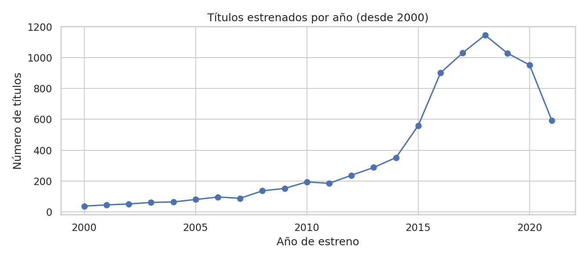

# Data-analysis-Python
Exploratory analysis of a public dataset using Pandas, Matplotlib, and Seaborn
# Netflix Catalog: Exploratory Data Analysis with Python

**English** | [Español](#análisis-exploratorio-del-catálogo-de-netflix-con-python)

Exploratory analysis of 8,807 titles (movies and TV shows) from the Netflix catalog, using Python, Pandas, Matplotlib and Seaborn.

## Questions this analysis answers
- What share of the catalog is movies and what share is TV shows?
- Which countries contribute the most titles?
- How does the number of releases change over the years?

## Main findings
- Movies make up 69.6 % of the catalog (6,131 titles), and TV shows make up 30.4 % (2,676 titles).
- The United States contributes 3,689 titles, more than three times India's 1,046, which ranks second.
- Releases grow strongly between 2013 and 2018, peaking in 2018 with 1,147 titles, and then decline.
- The dataset appears to end in 2021, so the last year may be incomplete.
- The director column has the most missing values (2,634). Missing values were filled instead of dropping rows.

## Visualizations







## Project structure
```
analisis-datos-python/
├── analisis.ipynb
├── tipo_titulo.png
├── top_paises.png
├── estrenos_por_anio.png
├── requirements.txt
└── README.md
```

## How to reproduce
1. Download the "Netflix Movies and TV Shows" dataset from Kaggle: https://www.kaggle.com/datasets/shivamb/netflix-shows
2. Open `analisis.ipynb` in Google Colab or Jupyter.
3. Upload `netflix_titles.csv` to the same folder as the notebook. In Colab, the file must be in `/content`.
4. Run the cells from top to bottom.

To run it on your own computer, first install the libraries with `pip install -r requirements.txt`.

## Methodology notes
- Missing countries were replaced with "Desconocido" and excluded from the ranking.
- A title with several countries is counted once per country, so country totals add up to more than the number of titles.
- Text dates were converted to date format so they can be grouped.

## Author
Franyer Pérez · [LinkedIn](https://www.linkedin.com/in/franyer-perez-1b569b450)

---

# Análisis exploratorio del catálogo de Netflix con Python

[English](#netflix-catalog-exploratory-data-analysis-with-python) | **Español**

Análisis exploratorio de 8,807 títulos (películas y series) del catálogo de Netflix, con Python, Pandas, Matplotlib y Seaborn.

## Preguntas que responde el análisis
- ¿Qué proporción del catálogo son películas y cuál son series?
- ¿Qué países aportan más títulos?
- ¿Cómo cambia la cantidad de estrenos por año?

## Hallazgos principales
- Las películas representan el 69.6 % del catálogo (6,131 títulos) y las series el 30.4 % (2,676 títulos).
- Estados Unidos aporta 3,689 títulos, más de tres veces lo que aporta India (1,046), que ocupa el segundo lugar.
- Los estrenos crecen con fuerza entre 2013 y 2018, con su máximo en 2018 (1,147 títulos), y después bajan.
- El dataset parece terminar en 2021, así que el último año puede estar incompleto.
- La columna de director es la que tiene más datos faltantes (2,634). Por eso se rellenaron los vacíos en lugar de borrar filas.

## Visualizaciones


## Estructura del proyecto
```
analisis-datos-python/
├── analisis.ipynb
├── tipo_titulo.png
├── top_paises.png
├── estrenos_por_anio.png
├── requirements.txt
└── README.md
```

## Cómo reproducirlo
1. Descarga el dataset "Netflix Movies and TV Shows" de Kaggle: https://www.kaggle.com/datasets/shivamb/netflix-shows
2. Abre `analisis.ipynb` en Google Colab o en Jupyter.
3. Sube `netflix_titles.csv` a la misma carpeta del notebook. En Colab, el archivo debe quedar en `/content`.
4. Ejecuta las celdas de arriba hacia abajo.

Si lo ejecutas en tu computadora, instala primero las librerías con `pip install -r requirements.txt`.

## Notas metodológicas
- Los países vacíos se reemplazaron por "Desconocido" y se excluyeron del ranking.
- Un título con varios países se cuenta una vez por cada país, así que las cifras por país suman más que el total de títulos.
- Las fechas de texto se convirtieron a formato de fecha para poder agruparlas.

## Autor
Franyer Pérez · [LinkedIn](https://www.linkedin.com/in/franyer-perez-1b569b450)
